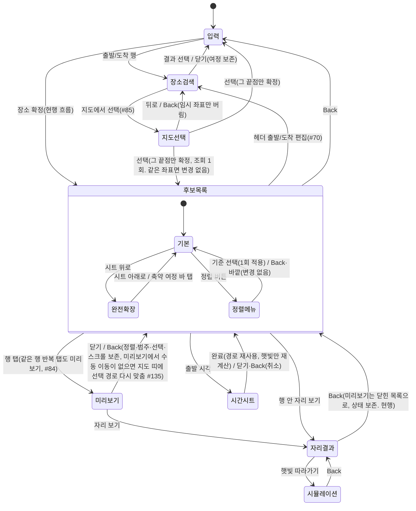

# DESIGN.md — 햇빛 좌석 디자인 계약

모든 화면과 공통 부품은 이 문서의 토큰과 규칙만 쓴다. 바꿀 때는 이 문서를 먼저 고치고 코드가 따라간다. 토큰 코드: `app/src/main/java/com/sunseat/app/ui/theme/`.

## 0. 이 문서의 지위와 이행 상태 (#97)

- #97에서 이 문서를 **길찾기 중심 계약**(제품 정체성·길찾기 관례·화면 역할·정보 위계·밀도·지도·행동·상태·접근성)으로 다시 정했다. 문서만 바뀌었고 제품 화면은 아직 바뀌지 않았다.
- `〔이행: #번호〕`가 붙은 규칙은 **새 기준이지만 아직 코드에 없다.** 해당 이슈의 PR이 병합되기 전까지 현재 코드는 그 부분에서 기존 규칙을 따른 상태로 본다(회귀가 아니다). 새 화면 코드는 처음부터 새 규칙을 쓴다.
- 이 문서를 고쳤다고 화면 개선을 완료로 표시하지 않는다. 각 구현은 15장의 이슈별 PR로 완료 관리한다.
- 새 토큰 이름(`Sizes.routeBar`, `SunSeatTheme.route` 등)은 **명세**다. 실제 이름은 구현 PR이 이 문서와 함께 확정하되 값·역할은 이 문서를 따른다.

## 1. 성격

- **모드: Operate.** 사람이 할 일은 "어느 경로로 가서 어느 쪽에 앉을지 정하기"다. 표현보다 훑어보기 쉬움과 정확함이 먼저다.
- **사용 장면: 밖, 햇빛 아래, 한 손.** 대비와 큰 터치 영역이 기본값이다.
- **인상: 해와 그늘.** 따뜻한 호박색(해)과 짙은 남색(그늘)이 의미이자 브랜드다. 햇빛/그늘·좌석 추천·태양/좌석 시뮬레이션은 제품 정체성으로 보존한다.
- **길찾기 관례를 따른다(#97).** 검색 → 후보 비교 → 선택 경로 이해 → 결정의 흐름, 소요시간 먼저·시간 비례 막대·연결된 승하차 타임라인, 조밀한 목록 행·탭·구분선 같은 한국 길찾기 앱의 **정보 위계와 조작 관례**를 참조한다. 카카오맵 등 참조 앱의 로고·브랜드색·광고·글꼴·서비스 범위는 복제하지 않는다. "카카오맵처럼"은 규칙이 아니다. 이 문서의 수치·역할이 규칙이다.
- 참고 원칙은 [design-references.md](design-references.md).

## 2. 색

기기 배경화면 색(Material You)은 쓰지 않는다. 해·그늘 색이 기기마다 바뀌면 의미가 흔들린다.

### 2.1 의미 색 (`SunSeatTheme.colors`)

| 토큰 | 밝은 화면 | 어두운 화면 | 쓰임 |
|---|---|---|---|
| `sun` | `#F2B01E` | `#F5BE3A` | 햇빛 구간 막대, 해 아이콘, 햇빛 좌석 |
| `onSun` | `#1E1602` | `#1E1602` | 해 색 위 글자 |
| `sunContainer` | `#FFF1C7` | `#3A2D0B` | 햇빛 알약 배경 |
| `onSunContainer` | `#6B4700` | `#FFE3A0` | 햇빛 알약 글자 |
| `shade` | `#2E4868` | `#5577A3` | 그늘 구간 막대, 그늘 아이콘, 그늘 좌석 |
| `shadeContainer` | `#DCE5F0` | `#22344B` | 그늘 알약 배경 |
| `onShadeContainer` | `#1E3350` | `#D6E3F5` | 그늘 알약 글자 |

### 2.2 Material 색 역할

| 역할 | 밝은 화면 | 어두운 화면 |
|---|---|---|
| `primary` / `onPrimary` | `#2E4868` / `#FFFFFF` | `#9DB9DD` / `#10243D` |
| `primaryContainer` / `on…` | `#DCE5F0` / `#1E3350` | `#22344B` / `#D6E3F5` |
| `tertiary` / `onTertiary` | `#7A5200` / `#FFFFFF` | `#F5BE3A` / `#2A1E00` |
| `background`·`surface` | `#F2F4F7` · `#FFFFFF` | `#0F141A` · `#18202A` |
| `surfaceContainerHigh` | `#E3E8EF` | `#202A35` |
| `onSurface` | `#16202C` | `#E8EDF2` |
| `onSurfaceVariant` | `#4A5666` | `#A9B5C3` |
| `inverseSurface` / `inverseOnSurface` | `#16202C` / `#F2F4F7` | `#E8EDF2` / `#16202C` |
| `outline` / `outlineVariant` | `#7A8696` / `#D3DAE3` | `#7D8998` / `#2B3643` |
| `error` | `#B3261E` | `#F2B8B5` |

선택 표시·테두리·아이콘처럼 글자가 아닌 요소도 배경 대비 3:1 이상이어야 한다. 호박색은 흰 배경 대비가 낮아 테두리·아이콘 선에 쓰지 않고 **채움**으로만 쓴다.

### 2.3 규칙
- **해·그늘 색은 의미 전용이다.** 호박색은 "햇빛", 남색은 "그늘"만 뜻한다. 버튼·선택 표시·장식·경로선에 쓰지 않는다.
- **채움 주 행동은 한 표면에 하나다.** 중립 잉크(`inverseSurface` 채움 + `inverseOnSurface` 글자) 채움 버튼은 화면(또는 열린 시트) 하나에 한 개만 둔다. 목록 행마다 반복되는 행동은 채움 버튼으로 만들지 않는다(4.3, 13장).
- **선택 상태는 종류마다 표현이 다르다(12.2).** 〔이행: #82, #83〕 연결형 버튼·필터 칩 선택은 중립 잉크 채움 + 체크, 범주 탭은 밑줄 표시, 현재 선택 경로는 행 배경 + 왼쪽 막대, 사용자 좌석은 중립 테두리 + 체크다.
- 본문 글자 대비 4.5:1 이상, 큰 글자(18sp 이상 굵게) 3:1 이상.
- 좌·우, 햇빛·그늘, 수단, 선택은 **색만으로 구분하지 않는다.** 글자 라벨·아이콘·패턴·semantics를 함께 둔다.
- 어두운 화면은 따로 설계한다. 색 반전으로 만들지 않는다.

### 2.4 노선 색

지하철 노선 공식 색(`TransitLineColors`)은 노선 **정체성 보조**다. 쓰는 곳은 (1) 노선 칩의 점(`Sizes.lineDot`, 노선 이름과 함께), (2) 시간 막대의 지하철 구간 띠(4.2), (3) 지도의 선택 경로 지하철 구간(2.5, 11장)뿐이다. 모두 글자 라벨이 함께 있어 색 대비만으로 의미를 전달하지 않는다. 해·그늘 의미 색과 별개다. 모르는 노선은 색을 추측하지 않고 `routeTransit`을 쓴다.

### 2.5 경로·수단·현재 선택 역할 (`SunSeatTheme.route`, 신규) 〔이행: #100〕

**결정:** 경로선과 이동수단, 현재 선택 경로에는 **별도 역할**을 둔다. 지금처럼 지도선에 본문 잉크(`onSurface`)와 `outline`을 자동 재사용하지 않는다. 이유: 굵은 검정/회색 선이 지명·도로를 덮고, 선택/대안/도보 차이가 두께와 명도에만 의존하며, 본문 글자와 같은 색이라 "경로"라는 의미가 없다. 카카오 파랑은 복제하지 않고 해(호박)·그늘(남색)과 색상이 겹치지 않는 **청록**을 우리 경로 색으로 정한다.

지도는 앱 화면 모드와 관계없이 밝은 바탕이므로 지도용 값은 **고정**이고, 지도 밖 UI(시간 막대·범례)용 값은 화면 모드를 따른다.

| 역할 | 지도(고정) | 밝은 UI | 어두운 UI | 쓰임 | 대비 근거 |
|---|---|---|---|---|---|
| `routeTransit` | `#0B6E75` | `#0B6E75` | `#5FC6CC` | 버스 구간, 노선 색 모르는 지하철, 자가용·택시 경로, 선택 경로 마커 | 흰색 6.0:1, `#F2F4F7` 5.4:1 / 어두운 `surface` 8.2:1 |
| `routeCasing` | `#FFFFFF` | — | — | 지도 선택 경로 양쪽 테두리(지도 지물과 분리) | — |
| `routeWalk` | `#4A5666` 점선 | `outline` 빗금 면 | `outline` 빗금 면 | 도보 구간 | 흰색 7.5:1 |
| `routeAlternate` | `#7A8696` | — | — | 목록 개요의 다른 후보 경로선(선택 미리보기에서는 그리지 않음, #99) | 흰색 3.7:1 |
| `routeOutlineLowContrast` | `#4A5666` 1dp | — | — | 흰 바탕 대비 3:1 미만 노선 색(현재 표: 3호선 2.8·4호선 2.8·9호선 2.2·경의중앙 2.1·수인분당 2.1)의 테두리. 이 노선은 흰 `routeCasing` **대신** 이 테두리를 속 4dp 바로 바깥 양쪽에 둔다(전체 6dp 동일) | 흰색 7.5:1 |
| `routePassed` | `#7A8696` | — | — | 시뮬레이션에서 지나온 구간 | 흰색 3.7:1 |
| `selectionContainer` | — | `surfaceContainerHigh` `#E3E8EF` | `#202A35` | 목록의 현재 선택 경로 행 배경 | 위 글자 `onSurface` 12:1 이상. 배경 자체는 `surface`와 대비가 낮아(1.2:1) 단독 단서로 쓰지 않고 왼쪽 막대와 함께 쓴다 |
| `selectionIndicator` | — | `onSurface` | `onSurface` | 현재 선택 행 왼쪽 막대(`Sizes.selectionBar`) | 배경 대비 3:1 이상 |

- 선택 경로의 구간 색: 지하철 = 노선 공식 색(없으면 `routeTransit`), 버스 = `routeTransit`, 도보 = `routeWalk` 점선, 자가용·택시 = `routeTransit`. 버스 유형별 색(간선·지선 등)은 이번 계약에서 만들지 않는다.
- 버스(`routeTransit` 청록)와 일부 노선 색(4호선·경의중앙)은 색상이 가깝다. 구분은 수단 글자 라벨·정류장 표식·막대 라벨로 하며, #100은 실제 지도에서 나란히 놓고 확인한다. 〔#100 결정: 값 유지〕 실기기(서울역→강남역 4호선 경로와 버스 경로)에서 청록 `#0B6E75`(흰 대비 6.0, 흰 테두리)는 4호선 `#00A5DE`(2.8, 어두운 테두리)와 명도·테두리가 모두 달라 혼동되지 않았다. 경의중앙(`#77C4A3`, 2.1)도 같은 명도·테두리 차이라 값을 바꾸지 않는다(경의중앙 실경로는 미확인).
- `routeTransit`은 의미가 "경로"다. 버튼·선택 표시·장식에 쓰지 않는다.
- 어두운 화면의 시간 막대는 `routeTransit` 어두운 값과 노선 공식 색을 쓰되, 공식 색이 어두운 `surface` 대비 3:1 미만이면 막대 띠 위에 1dp `outline` 테두리를 둔다.

### 2.6 지도 바탕과 주변 UI

지도 타일은 밝은 바탕으로 고정한다. 지도 위에 그리는 것(경로선·마커·해 방향 선·지도 위 라벨)은 2.5의 **지도(고정)** 값과 밝은 화면 의미 색을 쓴다. 지도 주변의 헤더·시트·카드·범례·안내는 앱 화면 모드(밝음/어두움)를 따른다. 어두운 화면에서 밝은 지도가 갑자기 튀지 않도록 지도와 시트 사이 경계에 `outlineVariant` 1dp 선을 둔다.

## 3. 글자

- 글꼴: **Pretendard 가변 글꼴**(OFL, `res/font/pretendard_variable.ttf`). 숫자는 고정폭 숫자(`tnum`)를 쓴다.
- 크기는 sp 단위. Material 글자 역할에만 대응시키고 화면마다 크기를 직접 정하지 않는다.

| 역할 | 크기/줄높이 | 굵기 | 쓰임 |
|---|---|---|---|
| `displaySmall` | 36/44 | 800 | 결과 결론 숫자 |
| `headlineMedium` | 28/36 | 800 | 결과 결론 문장("왼쪽 창가") |
| `headlineSmall` | 24/32 | 700 | 화면 제목 |
| `titleLarge` | 20/28 | 700 | 큰 구역 제목, **후보 행의 총 소요시간**(#98) |
| `titleMedium` | 17/24 | 700 | 카드 제목, 경로 이름, 여정 헤더 장소명 |
| `titleSmall` | 15/22 | 600 | 소제목, 타임라인 노선명, 범주 탭 |
| `bodyLarge` | 16/24 | 400 | 본문 |
| `bodyMedium` | 15/22 | 400 | 목록 본문, 시각·요금 줄, 정류장 이름 |
| `bodySmall` | 13/18 | 400 | 보조 설명, 데이터 범위 안내 |
| `labelLarge` | 16/20 | 700 | 버튼, 정렬 메뉴 버튼 |
| `labelMedium` | 13/16 | 600 | 알약, 배지, 시간 막대 라벨 |
| `labelSmall` | 12/16 | 500 | 축 눈금 |

굵은 제목은 자간을 −1~−2%로 살짝 좁힌다.

- **위계는 크기보다 순서·굵기·색으로 만든다.** 후보 행 안에서 `displaySmall`·`headline*`를 쓰지 않는다. 결과 화면의 결론만 큰 역할을 쓴다.
- **큰 글자에서 자동 축소 금지.** `autoSize`·글자 크기 하향·`maxLines=1` 강제로 맞추지 않는다. 말줄임은 4.4의 허용 목록에서만 쓴다.

## 4. 모양과 간격

- 모서리: `extraSmall 6` · `small 8` · `medium 12` · `large 16`(카드) · `extraLarge 24`(시트) · 캡슐(완전 둥글게, 떠 있는 컨트롤과 알약).
- 간격 단위 4dp: `xs 4` · `s 8` · `m 12` · `l 16` · `xl 24` · `xxl 32`. 화면 좌우 여백 16dp, 카드 안 여백 16dp, 카드 사이 12dp.
- 부품 크기(캡슐 여백, 아이콘, 타임라인, 그림)는 `Sizes` 토큰을 쓴다.
- 터치 영역 최소 **48×48dp**, 터치 대상 사이 8dp 이상. 예외: M3 연결형 버튼 묶음(`ChoiceGroup`)은 한 덩어리 컨트롤로 보고 버튼 사이 간격을 M3 기본값(`ButtonGroupDefaults.ConnectedSpaceBetween`)으로 둔다. 각 버튼은 48dp 이상이다.
- 연결형 선택 버튼은 현재 글자 크기의 라벨과 선택 체크를 포함한 폭을 확보한다. 공간이 충분하면 균등 배치하고, 부족하면 필요한 폭을 배분하거나 가로 탐색을 제공한다. 선택 항목은 보이는 위치로 이동하며 라벨을 줄이거나 자르지 않는다(#93). 설정 화면은 4.4의 예외를 따른다.
- 그림자 대신 면 색 차이(`background` 위 `surface`)로 층을 나눈다. 떠 있는 캡슐만 그림자를 쓴다.

### 4.1 표면 선택: 행·탭·구분선 vs 카드·캡슐 (#97) 〔이행: #82, #83〕

**결정:** 길찾기 목록과 시트 안은 **조밀한 행 + 구분선**이 기본이고, 카드는 서로 다른 성격의 내용 묶음에만 쓴다. 이유: 현재 후보 시트는 목록 위에 큰 칩 두 줄(정렬 5개 가로 스크롤 + 범주 3개)이 있고, 후보마다 `large` 모서리 카드(`Surface`) 안에 큰 막대·전 구간 문장·큰 햇빛 알약·가로 전체 채움 버튼이 반복돼 다음 후보가 거의 보이지 않는다(`candidates_list_light.png`). 현재 카드의 선택 표시(`surfaceContainerHigh` 배경 + `onSurface` 테두리 + 체크)는 12.2의 행 배경 + 왼쪽 막대로 바뀐다.

| 부품 | 쓰는 조건 | 쓰지 않는 조건 |
|---|---|---|
| 목록 행(`ListRow`) | 같은 종류 항목의 비교(경로 후보, 검색 결과, 최근 장소, 설정 항목) | 결론 하나를 강조할 때 |
| 구분선 | 목록 행 사이. `outlineVariant` `Sizes.hairline`, 왼쪽 들여쓰기 `Spacing.l` | 카드 테두리 대용 |
| 탭(`CategoryTabs`) | 같은 목록의 상호 배타 범주(전체/버스/지하철/혼합 + 개수, #82) | 설정값 저장, 여러 개 동시 선택 |
| 드롭다운 버튼 | 현재 기준이 하나인 정렬(#83), 현재값이 보이는 설정(#104) | 2개 이하 즉시 전환(연결형 버튼이 낫다) |
| 연결형 버튼(`ChoiceGroup`) | 2~3개 즉시 전환이 한 줄에 다 들어갈 때(수단, 좌석 비교) | 선택지가 가로 화면 밖으로 밀려날 때 |
| 연결 타임라인 | 승차 → 환승 → 하차 순서(후보 행, 미리보기 펼침, 결과 구간) | 단일 구간 |
| 카드(`SectionCard`) | 결과 화면의 결론/근거/세부처럼 성격이 다른 구역, 설정의 구역 | **시트 안 목록 항목, 카드 안의 카드(중첩 금지)** |
| 떠 있는 캡슐 | 지도/스크롤 위에 떠야 하는 여정 바·하단 행동 바(5장), 미리보기 지도 위 "지도 맞춤"(#102) | 목록 안, 시트 안 |

### 4.2 밀도 토큰 (신규 명세) 〔이행: #82, #83, #104〕 (`Sizes.journeyBar`는 #101, `Sizes.tabHeight`·`Sizes.tabIndicator`와 범주 탭 `CategoryTabs`는 #82, 정렬 드롭다운 버튼은 #83, 미리보기 적용은 #102에서 적용. #103 여정 헤더는 기존 토큰만 쓴다)

값은 dp, 글자 배율 1.0 기준이며 **최소값**이다. 큰 글자에서는 높이가 내용에 맞춰 늘어나고 줄어들지 않는다.

| 토큰(명세) | 값 | 쓰임 |
|---|---|---|
| `Spacing.touch` (기존) | 48 | 모든 터치 대상 최소 |
| `Sizes.listRow` (기존) | 44 | 터치하지 않는 정보 행 최소 높이 |
| `Sizes.listRowInteractive` | 56 | 터치하는 한 줄 행(검색 결과·설정 행) |
| 후보 행 안쪽 여백 | 세로 `Spacing.m` 12 · 가로 `Spacing.l` 16 | 행 내부 줄 사이 `Spacing.xs`~`Spacing.s` |
| `Sizes.topBar` | 56 | 후보·미리보기·설정의 상단 바 |
| `Sizes.journeyBar` | 56 | 축약 여정 바(5.1) |
| `Sizes.tabHeight` · `Sizes.tabIndicator` | 48 · 3 | 범주 탭과 선택 밑줄 |
| `Sizes.badgeHeight` | 24 | 배지(가장 빠름 등). `labelMedium`, `extraSmall` 모서리 |
| `Sizes.compactPillHeight` | 28 | 후보 행의 햇빛/그늘 요약 알약(`ExposurePill` 작은 변형, 아이콘 `iconSmall`) |
| `Sizes.secondaryButton` | 40 (보이는 높이) | 행 안 보조 행동(자리 보기). 터치 영역은 48로 확장 |
| `Sizes.routeBar` · `Sizes.routeBarGap` | 8 · 2 | 시간 비례 막대 띠 높이와 구간 사이 틈 |
| `Sizes.timelineNode` · `Sizes.timelineConnector` | 12 · 2 | 연결 타임라인 정류장 점과 세로 연결선 |
| `Sizes.selectionBar` | 4 | 현재 선택 경로 행 왼쪽 막대 |
| `Sizes.mapRouteSelected` | 6 (속 4 + 양쪽 `routeCasing` 1) | 지도 선택 경로 |
| `Sizes.mapRouteWalk` | 3, 점 3 / 간격 3 | 지도 도보 |
| `Sizes.mapRouteAlternate` | 3, 테두리 없음 | 지도 다른 후보(목록 개요만) |
| `Sizes.mapStopMarker` | 14 | 승차·환승·하차 정류장 표식(흰 채움 + 구간 색 2dp 테두리) |
| `Sizes.mapMarker` (기존) | 32 | 출발·도착 표식(글자 "출발"·"도착" 포함) |

- 지도 선 두께는 **논리 dp**다. 〔#100 확정〕 Kakao SDK 2.15.2는 RouteLineStyle의 lineWidth/strokeWidth에 `KakaoMap.getMapDpScale()`을 다시 곱한다(공식 주의사항 "API에서 입력받는 모든 pixel 값과 이미지 크기는 dp 값에 영향을 받는다"). SM-S936N(density 3.75)에서 mapDpScale은 1.6977이었고, 수정 전 7dp 지하철선 인자 26.25px가 실측 45px, 5dp 버스선 18.75px가 실측 약 31px로 렌더됐다(인자 × 1.70). 그래서 선 두께 인자는 `dp × density ÷ mapDpScale`로 넘긴다(`RouteLinePolicy.sdkWidth`, 상수로 나누지 않고 지도에서 읽은 값). 수정 후 같은 기기에서 6dp 선택선 22px(속 15 + 양쪽 3~4), 줌을 3단계 바꿔도 같다. 라벨 이미지는 `setApplyDpScale(false)`에 픽셀 크기를 넘긴다.
- 〔#100〕 SDK 2.15.2의 `RouteLinePattern` 이미지는 실기기에서 그려지지 않았다(공식 예제 그대로도 무표시/흰 선). 그래서 도보 점선과 진행 방향 쉐브론은 현재 줌의 미터/픽셀로 좌표에서 만든다: 도보 = 선 두께만큼의 짧은 선(둥근 끝)을 `mapRouteWalk + mapRouteWalkGap` 간격으로, 쉐브론 = `mapRouteArrowSpacing` 72 간격(첫 표식은 절반 지점, 구간이 간격보다 짧으면 없음)의 회전 라벨. 줌 단계가 바뀔 때만 다시 만든다. 재생 중에는 쉐브론을 숨긴다(차량 표식과 혼동 방지).
- 기존 `Sizes.mapRoute 5`·`mapSubway 7`·`mapWalk 3`은 위 값으로 대체했다(#100).

### 4.3 행동 크기 단계

| 단계 | 모양 | 쓰는 곳 |
|---|---|---|
| 주 행동 | `PrimaryButton`: 중립 잉크 채움 캡슐, 높이 48 이상, 보통 가로 전체 | 표면당 1개(13장 표) |
| 보조 행동(행 안) | 테두리 버튼: `outline` 1dp 캡슐, 보이는 높이 40·터치 48, `labelLarge` | 후보 행의 자리 보기 |
| 조용한 행동 | `QuietButton`: 글자 버튼, 높이 48 | 다시 찾기, 지도 맞춤(#102), 시간·햇빛 목적 열기 |
| 아이콘 행동 | 아이콘 24 + 터치 48, contentDescription 필수 | 뒤로, 닫기, 맞바꾸기, 설정 |

- 같은 행동은 화면마다 같은 단계를 쓴다. "자리 보기"는 후보 행에서는 보조, 미리보기에서는 주 행동이다.
- 빈 공간을 이유로 버튼을 키우지 않는다.

### 4.4 큰 글자·작은 화면 예외

판단 기준은 기기 값을 추측하지 않고 **실제 측정 폭**으로 한다. 검증 기준 상태: 390dp·320dp 폭 × 글자 1.0·1.5배.

- **재배치 우선:** 한 줄에 안 들어가면 다음 줄로 흐르게 한다(시각·요금 → 두 줄, 막대 라벨 → 줄바꿈, 알약 → 다음 줄). 높이는 늘어나도 된다.
- **말줄임 허용 목록:** 축약 여정 바의 장소명(펼치면 전체 이름, semantics에 전체 이름), 검색 결과 주소 보조 줄. 그 외(노선명·정류장명·버튼·탭·선택지 라벨)는 말줄임하지 않는다.
- **가로 스크롤 허용 조건:** 범주 탭이 한 줄에 안 들어갈 때만. 다음 탭이 일부 보이도록 끝 여백을 두고 선택 탭을 보이는 위치로 옮긴다. 설정 화면은 가로 스크롤을 쓰지 않는다.
- **설정 선택지(#104 결정):** 2~3개 고정 선택지는 측정 폭에 모두 들어가면 연결형 버튼, 들어가지 않으면 **세로 라디오 목록**(행 56 이상, 선택 체크 + semantics selected)으로 바꾼다. 공통 `ChoiceGroup` 동작을 전역 변경하지 않고 설정 전용 래퍼(`SettingsChoice`)로 한다. 한 화면 안에서 연결형 버튼과 라디오 목록을 섞지 않도록 가장 넓은 선택지 묶음을 기준으로 모두 함께 바꾼다. 지하철 비교 기준도 같은 라디오 목록 부품을 쓴다. #93의 한 줄 라벨 계약은 유지한다.
- 터치 영역(48)·대비·라벨은 큰 글자에서도 줄이지 않는다.

## 5. 떠 있는 캡슐과 여정 헤더

- 떠 있는 캡슐(`FloatingCapsule`)은 결과 화면의 상단 여정 바와 하단 행동 바, 선택 미리보기 지도 위 "지도 맞춤"(#102)만 쓴다. 불투명 `surface` + `outlineVariant` 테두리 + 그림자 8dp.
- 캡슐 안 글자·아이콘은 `onSurface`만 쓴다. 예외: 결과 상단 캡슐의 조건 줄(수단·출발·도착 시각)은 축약 여정 바와 같은 `onSurfaceVariant`(대비 4.5:1 이상, #103).
- 캡슐 뒤로 핵심 정보 글자가 가려지지 않도록 스크롤 끝에 캡슐 높이만큼 여백을 둔다(`Sizes.bottomCapsuleClearance`).
- 블러·유리 효과는 쓰지 않는다(1차 점검 결정, #28).

### 5.1 여정 헤더 공통 규칙 (펼친 헤더 공통 부품 `JourneyHeader`·입력 한 표면·측정 높이 지도 여백·축약 여정 글 `JourneySummary`는 #103, 후보 확장의 축약 여정 바·헤더 조각 제거는 #101, 미리보기 축약 여정 바는 #102에서 적용)

같은 여정(출발·도착·수단·출발 시각·햇빛 목적)을 화면마다 같은 순서와 같은 위치에서 읽고 고친다.

- **읽기 순서:** 출발 → 도착 → (맞바꾸기) → 수단 → 출발 시각 → 햇빛 목적.
- **펼친 헤더**(입력, 후보 목록 기본): 출발·도착 두 행(각 48 이상, 라벨 "출발"/"도착" + 장소명 `titleMedium`) 사이 구분선, 오른쪽에 맞바꾸기 아이콘 행동. 그 아래 한 줄에 수단 연결형 버튼, 다음 줄에 출발 시각·햇빛 목적 조용한 행동. 입력 화면에서는 이것을 **한 개의 표면**으로 묶는다(#103 전에는 두 카드). 설정 진입 아이콘은 장소 행과 떨어진 오른쪽 위에 둔다.
- **축약 여정 바**(후보 시트 완전 확장, 미리보기, 결과): 높이 `Sizes.journeyBar` 이상. 1줄 "서울역 → 강남역"(`titleMedium`, 필요하면 2줄까지 줄바꿈, 그 이상은 말줄임 허용) + 2줄 "대중교통 · 09:00 출발"(`bodySmall`). 바를 누르면 펼친 헤더로 돌아가 편집할 수 있다. 결과 화면에서는 이 바가 상단 캡슐이다.
- 헤더는 **완전히 보이거나 완전히 접힌다.** 한 글줄 조각만 남기지 않는다(#101). 가려진 컨트롤은 접근성 초점에서도 빠진다.
- 지도 여백은 헤더의 **실제 측정 높이**로 준다(고정 `Sizes.mapHeight` 추정 금지, #103).
- 〔#103 적용〕 입력과 후보 목록 기본 상태는 같은 부품(`JourneyHeader`)을 쓴다. 차이는 화면 역할뿐이다: 후보 목록은 앞에 뒤로 하나, 입력은 장소 행 바깥 오른쪽 위에 설정(그 아래 맞바꾸기). 출발 시각·햇빛 목적은 두 화면 모두 헤더에서 열며, 공간이 부족하면 다음 줄로 흐르고 가로 스크롤로 숨기지 않는다. 같은 햇빛 목적을 다시 고르면 바꾸지 않는다. 후보 목록에서 햇빛 목적을 바꾸면 경로는 다시 찾지 않고 햇빛만 다시 계산한다(시각 변경과 같은 계약).
- 〔#103 적용〕 펼친 헤더의 장소명은 말줄임 없이 줄바꿈한다(4.4). 입력 헤더 표면이 화면 아래로 터치 3개 높이를 남기지 못하면(가로·큰 글자) 표면 안에서 스크롤하고(모서리 유지, 더 있으면 아래 가장자리 구분선) 지도 여백은 잘린 표면의 아래끝이다. 지도 아래 여백은 현재 위치 버튼 높이다(세로 화면만. 가로 화면은 지도 띠가 낮아 0). 입력 지도는 여백·안내가 바뀌어도 카메라를 다시 맞추지 않고 끝점이 바뀔 때만 맞춘다(수동 이동 보존).
- 〔#103 적용〕 축약 여정 바(후보 완전 확장·미리보기)와 결과 상단 캡슐은 같은 글 부품(`JourneySummary`)을 쓴다. 결과 캡슐 제목도 2줄까지 줄바꿈하고 조건 줄은 `onSurfaceVariant`다.

## 6. 아이콘

- 일반 아이콘: Material Symbols Rounded에서 필요한 것만 벡터로 넣는다(`res/drawable/ic_ms_*.xml`).
- 이 앱만의 아이콘(해·좌석·진행 방향)은 직접 그린다(`ui/icons/SunSeatIcons.kt`). 선 굵기 2dp, 둥근 끝.
- 해 그림은 짧은 햇살이 있는 원으로 그린다. 붉은 방사선이 화면 가장자리까지 뻗는 형태(욱일기를 연상시키는 형태)는 쓰지 않는다.
- 수단 아이콘(버스·지하철·도보·자동차)은 지원하는 수단만 둔다. 도보·자전거 검색을 지원하는 것처럼 보이는 아이콘을 추가하지 않는다(#103).

## 6.1 정보 그림

- 해 방향은 위에서 내려다본 차량으로 그린다. 진행 방향은 항상 위쪽 화살표, 양옆에 "왼쪽·오른쪽" 글자와 햇빛·그늘 알약을 둔다.
- 타임라인 눈금은 실제 시각 비율 위치에 둔다. 범례(햇빛·그늘)를 함께 두고, 해 구간에는 사선 무늬(불투명도 35%)를 겹친다.
- 화면 순서는 결론 → 근거(그림, 타임라인) → 세부(구간별). 결론 문구는 비교 전환으로 바뀌지 않는다.

### 6.2 시간 비례 막대와 연결 타임라인 (#98, #105)

- **막대:** 높이 `Sizes.routeBar` 8의 띠. 구간 폭은 시간 비례, 구간 사이 `Sizes.routeBarGap` 2 틈(색 대비에 의존하지 않고 경계를 보인다). 버스 = `routeTransit`, 지하철 = 노선 색, 도보 = `routeWalk` 빗금 면. 띠 안에 글자를 넣지 않는다(지금의 "도…" 잘림 원인).
- **막대 라벨:** 띠 바로 아래 한 줄에 "버스 12분 · 도보 3분 · 2호선 20분"처럼 수단(글자)+알려진 구간 시간. 넘치면 줄바꿈. 1분 미만 도보는 "1분 미만"으로 쓰고 0분으로 바꾸지 않는다.
- **막대 기준:** 제공된 구간 시간 합에 비례한다. API 총 소요시간과 구간 합의 차이를 도보·대기로 단정해 채우지 않는다. 차이의 의미는 목록 공통 안내로 설명한다(#105, 14장).
- **펼침 정책(#98):** 모든 후보는 총시간·시각/요금·시간 막대/라벨·환승·탑승 노선 요약·자리 보기를 유지한다. 현재 선택한 후보에만 연결 타임라인을 펼친다. 행 탭은 반복해도 지도 미리보기만 열고, 자리 결과는 명시적 자리 보기로만 연다.
- **공통 범위 안내(#98):** 목록의 48dp 조용한 정보 행동으로 도보·막대·햇빛 계산 범위를 연다. 안내 본문은 #105의 문구를 유지하며 제공 구간 합과 총시간 차이를 임의의 도보/대기로 채우지 않음을 설명한다.
- **연결 타임라인:** 원래 탑승 단계마다 정류장 점(`Sizes.timelineNode`) 하나와 노선명(`titleSmall`)·승차 정류장(`bodyMedium`), 마지막에 하차 점. 점 사이 세로 연결선(`Sizes.timelineConnector`)은 구간 색, 도보 연결은 점선 + "도보 3분" 주석. 계산용으로 나눈 역 구간(#92)은 새 점으로 만들지 않는다. 선택 행 배경 대비 3:1 미만 노선색의 점·연결선에는 `outline` 1dp 테두리를 보강한다. 미제공 정류장·접근 도보는 만들지 않는다.

## 7. 움직임과 반응

- 기본은 Material 3 Expressive 움직임(`MotionScheme.expressive()`, 스프링).
- 쓰는 곳: 화면 전환(경로 정보 공유 요소 전환), 결과 등장(카드 순차 등장·숫자 올라감·막대 채움), 좌·우 전환(표시 이동·내용 교차 전환).
- 장식용 반복 애니메이션은 쓰지 않는다.
- **로딩 연출 예외(1차 점검 결정):** 기다리는 동안에만 Lottie 해 애니메이션(`SunLoader`, 직접 제작 `res/raw/sun_loading.json`)을 반복 재생한다. 색은 `sun` 토큰으로 칠하고 크기는 `Sizes.loader`. 뼈대 로딩과 함께 쓰되 문구 옆 작은 크기로 두며, 애니메이션 삭제 설정이면 멈춘다. 로딩 외 화면에는 쓰지 않는다.
- 시스템 "애니메이션 삭제" 설정이 켜져 있으면 움직임 없이 바로 바꾼다(`rememberReduceMotion()`).
- 뒤로가기 화면 전환은 앱 버튼·시스템 Back·예측 제스처 모두 페이드·축소 없이 즉시 복귀한다(#67). 제스처 취소는 현재 화면을 유지한다. 하단 시트와 검색 닫기의 자체 동작은 유지한다.
- 햅틱(`SunSeatHaptics`)은 **사용자가 직접 조작한 순간에만** 쓴다. 화면이 뜨거나 결과가 표시되는 것처럼 저절로 일어나는 일에는 진동을 주지 않는다. 시스템 터치 진동 설정을 따른다.

| 종류 | 언제 | 구현 |
|---|---|---|
| 누름 확인 | 주 행동 버튼, 경로 선택처럼 다음 화면으로 넘어가는 선택 | `HapticFeedbackType.Confirm` |
| 선택 전환 | 좌·우, 수단, 모드, 범주 탭, 정렬 기준 전환 | `HapticFeedbackType.SegmentTick` |

## 8. 금지

- Material 기본 보라 테마, 기기 배경화면 색.
- 블러·유리 효과(어디에도 쓰지 않는다).
- 색만으로 의미 구분.
- 연한 회색(대비 4.5:1 미만) 본문.
- 화면 코드에 색·크기 숫자 직접 쓰기(토큰 사용).
- 장식용 그라데이션 배경·풍경 일러스트, 반복 애니메이션, 이모지 아이콘.
- 해·그늘 색과 경로 색(`routeTransit`)을 버튼·선택 표시에 쓰기.
- 지도선에 본문 잉크(`onSurface`)를 경로 색으로 쓰기.
- 카드 안에 카드, 목록 행마다 채움 주 행동 버튼.
- 큰 글자 대응을 글자 축소·말줄임·`maxLines=1`로 하기(4.4 허용 목록 제외).
- 참조 앱의 로고·브랜드색·글꼴 복제, 공급되지 않는 정보(실시간 도착·혼잡도·접근 도보) 흉내.

## 9. 검사

- **Roborazzi 스크린샷:** 화면·부품마다 밝은·어두운 화면, 주요 상태. `./gradlew recordRoborazziDebug`로 기준 이미지를 만들고 `verifyRoborazziDebug`로 비교한다. 기준 이미지는 CI Ubuntu의 `record-screenshots.yml`에서 기록한 정본만 커밋한다. 로컬과 CI에서 `verifyRoborazziDebug`를 실행하며 차이가 있으면 CI가 기준이다.
- **접근성 자동 검사:** Compose `enableAccessibilityChecks()`로 터치 영역·대비·라벨을 검사한다(JVM 테스트). 실제 기기 확인이 최종 기준이다.
- **Impeccable:** `.claude/skills/impeccable`의 `critique`·`audit` 절차로 비평한다. Android 기준은 `reference/android.md`.
- **독립 디자인 리뷰:** 화면을 만든 쪽과 분리된 리뷰어가 스크린샷을 보고 위계·가독성·색·상태·접근성을 판정한다. 지적은 고치거나 이유를 남긴다.
- PREVIEW/Robolectric 렌더는 네이티브 지도·GPU·제스처 검증을 대신하지 않는다. 실기기 미검증 항목은 PR에 그대로 적는다.

### 9.1 길찾기 화면 검토 체크리스트 (#97)

화면 PR과 리뷰어는 해당 항목을 확인한다.

1. 이 화면의 주 과업과 채움 주 행동이 12장 표와 같은가? 채움 버튼이 표면당 하나인가?
2. 추천 / 현재 선택 경로 / 선택한 수단·필터 / 사용자 좌석이 12.2의 서로 다른 표현으로 구분되는가? 색 외 단서(글자·체크·막대·semantics)가 있는가?
3. 시트 안 목록이 행+구분선인가? 카드 중첩이 없는가?
4. 390dp·1.0에서 후보 목록 완전 확장 시 후보 두 개 이상의 총시간·막대·탑승 요약이 보이는가? 320dp·1.5배에서 후보 하나 전체와 다음 후보의 총시간이 보이는가?
5. 큰 글자에서 글자 축소·말줄임 없이 재배치되는가(4.4)? 48dp 터치를 지키는가?
6. 지도선이 2.5 역할을 쓰고 지명을 과하게 덮지 않는가? 선택 미리보기에 다른 후보가 섞이지 않는가(#99)?
7. 헤더가 완전히 보이거나 완전히 접히는가(조각 없음)? Back 순서가 12.3과 같은가?
8. 제공되지 않은 정보를 만들거나 0으로 표시하지 않았는가? "경로는 현재 기준, 햇빛은 고른 출발 시각" 안내가 지켜지는가(14장)?
9. 밝음/어두움, 긴 이름·누락·0건·밤·자정 통과·로딩/오류 상태를 찍었는가?
10. #67/#69/#70/#71/#72/#73/#74/#81/#84/#92/#93 계약(16.7)을 되돌리지 않았는가?

## 10. 문구

- 해요체로 짧게 쓴다. 한 문장에는 정보 하나, 화면 문구는 40자 안팎으로 쓰며 필요한 설명만 한 줄로 덧붙인다. 결론 외에는 명령보다 안내를 쓴다. API·쿼터 같은 기술 용어는 화면에 쓰지 않는다.

| 대상 | 표준 용어 |
|---|---|
| 버스·지하철 공통 | 자리 |
| 차량 좌석 이름 | 조수석, 뒷좌석 왼쪽/오른쪽 |
| 창 쪽 자리 | 창가 |
| 좌우 방향 | 진행 방향 왼쪽/오른쪽 |
| 노출 상태 | 햇빛, 그늘 |
| 이동 정보 | 출발, 도착, 경로, 구간, 도보, 환승 |
| 저장·환경 | 즐겨찾기, 설정 |

- 숫자는 “1시간 5분”, “환승 1회”, “1,550원”, 시각은 “09:00”으로 표시한다. 다음 날 도착은 “다음 날 00:20”처럼 날짜를 밝힌다.
- 빈 상태·오류는 무엇이 안 됐는지와 가능한 행동을 한 줄씩 안내한다. 버튼은 짧은 동사형으로 쓴다.
- 리소스 이름은 `<화면>_<요소>`, 공통 문구는 `common_`으로 시작한다. 도메인은 표시 문구나 Android 리소스를 알지 않는다.

## 11. 지도

카카오 일반 지도는 앱 화면 모드와 관계없이 밝은 바탕이다(2.6). 지도 위 경로선·마커·해 방향 선은 2.5의 지도 고정 값과 밝은 화면 의미 색을 쓴다. 지도 주변 카드·범례·안내는 앱 화면 모드를 따른다. 테스트 대체 지도도 같은 밝은 바탕으로 검증한다. Kakao 로고와 필수 지도 표식은 가리지 않는다. 시뮬레이션의 수동 탐색 후 표시하는 따라가기 버튼은 지도 아래 별도 행에 두어 로고와 도착 표식에 겹치지 않는다(#122).

### 11.1 경로선과 표식 〔이행: #100, 노출 정책은 #99〕

#100 이전 코드는 모든 선택 경로를 `LightScheme.onSurface`, 대안을 `outline`으로 굵게(5~7dp × SDK 배율 1.7) 그렸다. 계약(`RouteLinePolicy`가 네이티브와 테스트 렌더러에 같은 값을 준다):

| 대상 | 모양 | 레이어(아래→위) |
|---|---|---|
| 다른 후보(목록 개요만) | `routeAlternate` 3dp, 테두리 없음 | 1 |
| 선택 경로 도보 | `routeWalk` 점선 3dp | 2 |
| 선택 경로 탑승 구간 | 구간 색(2.5) 속 4dp + `routeCasing` 1dp 양쪽, 진행 방향 화살표(구간 길이가 충분할 때) | 3 |
| 승차·환승·하차 표식 | `Sizes.mapStopMarker` 흰 원 + 구간 색 2dp 테두리. 환승 표식에 다음 노선 이름 라벨(겹치면 숨기고 TalkBack 요약으로 제공). 〔#100〕 환승은 다음 탑승 지점의 표식 하나로 나타낸다(짧은 환승 도보에서 하차·승차 원 두 개가 겹치던 실기기 결과). 같은 탑승의 역 구간(`transitStepIndex` 같음)은 묶는다 | 4 |
| 출발·도착 | `Sizes.mapMarker` 글자 표식 "출발"(흰 채움 + `routeTransit` 테두리)·"도착"(`routeTransit` 채움 + 흰 글자). 원/네모 모양만으로 구분하지 않는다 | 5 |
| 현재 위치 | 기존 현재 위치 표식. 출발 표식과 모양·라벨이 다르다(#68) | 5 |

- **노출 정책(#99):** 후보 목록 개요에서는 다른 후보를 `routeAlternate`로 함께 그릴 수 있다. **선택 미리보기와 결과·시뮬레이션은 선택 경로만** 그린다. 미리보기의 "지도 맞춤"(#102 전 "전체 경로 보기")은 선택 경로 전체에 카메라를 맞추는 행동이며 다른 후보를 다시 불러오지 않는다.
- 근거 없는 정류장 표식은 만들지 않는다. 지도선과 목록의 탑승 단계가 같은 경로여야 한다.
- TalkBack: 지도에 "선택 경로: 1호선 서울역 승차 → 시청 2호선 환승 → 강남역 하차" 같은 요약을 지도 설명과 별도 노드로 둔다(#100). 노선 이름이 없으면 "버스"·"지하철"로 읽는다.
- 〔#100〕 출발·도착 표식이 글자를 품으므로 지도 왼쪽 위의 별도 범례(원/네모 + 출발·도착)는 없앴다. 범례 상자가 출발 표식을 가리던 결과 화면 실기기 결과.
- PREVIEW(Compose 대체 렌더)와 네이티브 SDK의 단위·패턴·레이어 순서를 같은 계약으로 맞춘다(#100).

### 지도에서 위치 선택 (#85)

- 장소 검색의 "지도에서 선택" 행(검색어가 있어도 보인다)으로 연다. 편집 중인 칸(출발/도착)을 유지하고 아래의 검색 상태(검색어)는 그대로 둔다. 즐겨찾기 검색에는 두지 않는다.
- 배치: 상단 바(뒤로 + 제목 "지도에서 출발지/도착지 선택") · 지도 · 하단 패널(주소 + 안내 + 주 행동 하나). 지도는 막대·패널과 겹치지 않는 영역에 그리고 여백(padding)을 주지 않아 **보이는 지도의 가운데 = 카메라 가운데 = 핀 끝**이다. 핀은 11.1 출발·도착 글자 표식과 같은 모양이며 꼬리 끝이 좌표다. 편집 중인 끝점의 표식은 핀으로 대신하고 반대 끝점 표식은 남긴다. 현재 위치 버튼은 지도 오른쪽 위(Kakao 로고와 겹치지 않음)에 두고 카메라만 옮긴다(#68).
- 시작 위치: 그 칸의 기존 끝점 → 반대 끝점 → 이미 받은 지도 현재 위치 → 서울시청. 위치 권한을 요구하지 않는다. 줌은 거리 단위(17)로 연다.
- 주소: 지도가 멈출 때만(`onCameraIdle`) 300ms 기다려 마지막 좌표 하나를 카카오 로컬 좌표→주소(`coord2address`)로 조회한다. 매 프레임 호출하지 않고, 요청 세대와 좌표를 확인해 예전 응답을 새 좌표에 붙이지 않는다. 도로명 주소 → 지번 주소 순으로 쓰고 근처 상호 이름은 붙이지 않는다. 주소가 없거나 조회에 실패해도 좌표는 확정할 수 있으며 이름은 "지도에서 선택한 위치"다(실패면 다시 시도 조용한 행동). 이름 없는 선택은 최근 장소에 남기지 않는다.
- 지도를 움직이는 동안과 지도를 쓸 수 없을 때(키 없음·인증 실패)는 선택 버튼을 끈다. 지도를 쓸 수 없으면 핀을 숨기고 뒤로 가서 검색하라고 안내한다.
- 선택: 반대 끝점과 같은 좌표면 패널에 "출발지와 도착지가 같아요"를 보이고 확정하지 않는다. 그 칸의 기존 끝점과 같은 좌표면 아무것도 바꾸지 않고 닫는다. 그 밖에는 그 끝점만 바꾸고 수단·출발 시각·햇빛 목적은 유지하며 경로 조회는 한 번이다(#70 계약). 뒤로/Back은 임시 좌표만 버리고 검색으로 돌아간다.
- TalkBack: 지도 노드는 "지도에서 도착지 선택 지도. 가운데 핀 위치: <주소>"로 읽고, 주소 줄은 polite 라이브 영역이다. 뒤로·현재 위치로 지도 이동·선택은 서로 다른 이름의 버튼이다. 지도 끌기가 어려우면 검색·현재 위치 경로를 그대로 쓴다.

### 햇빛 따라가기 (#42)

지도/차량 패널은 조작 막대를 제외한 영역에서 세로에서는 2:3 비율이고 가로에서는 좌우로 나란히 배치한다(#56). 세로에서는 3D 장면보다 먼저 선택 좌석과 직사광 요약을 보여 준다. 가로에서는 시스템 바와 큰 글자로 요약이 늘어나도 장면이 조작 막대 뒤로 밀리지 않도록 장면을 차량 패널 맨 위에 두고, 선택 좌석·직사광 요약과 자리 고르기는 장면 바로 아래에서 스크롤한다(#113). 장면은 세로 Sizes.cabinHeight, 가로 Sizes.cabinLandscapeHeight(조작 막대 위에 스크롤 없이 들어가는 높이)를 쓰고 전체/좌석 시점과 직접 좌석 선택을 제공한다. 프레이밍은 카메라만 움직이고 좌석·차량 치수와 빛 계산은 바꾸지 않는다(#75, CabinCamera). 전체 시점은 앞-오른쪽 위에서 보이는 차체 전체를 화면에 맞추고 가장 먼 좌석이 가장 크게 보이는 각도를 고르며 좌석 선택과 무관하게 고정된다. 내 자리 시점은 선택 좌석의 좌판·등받이를 화면에 맞추되 카메라를 차내에 두고 다른 좌석·기둥에 가리지 않는 각도를 고른다. 두 시점 모두 좌석은 시점 전환 버튼 아래에 두지 않는다. 새 배치(#76)도 CabinCameraTest의 같은 계약을 통과해야 한다. 호박색은 직사광, 남색 계열은 그늘, 중립 연속 테두리는 선택 좌석을 뜻하며 문구로도 구분한다. 표준 모형의 치수·배치와 빛 계산의 가정을 짧게 안내한다. 조작 막대는 아래에 고정하고 작은 화면의 차량 패널은 스크롤한다. 진행한 경로는 중립 잉크, 남은 경로는 중립 outline이다. 〔#97 변경, 이행: #100 — #42에서 정한 재생 색을 뒤집는 의도한 변경이다〕 지나온 구간은 `routePassed`(회색), 남은 구간은 선택 경로와 같은 구간 색으로 바꾼다. 이유: 지도선 전체가 경로 색 체계(11.1)로 바뀌므로 재생에서도 "남은 길 = 경로 색, 지난 길 = 회색"으로 일관되게 읽힌다. 위 지도는 현재 시각·이동률·태양 방향/고도·출발→도착을 고정 안내한다. 이동 마커는 진행 방향으로 회전하며 해 쪽을 호박색으로 채운다. 해 아이콘에서 차량으로 향하는 광선으로 대략적인 입사 방향을 표시한다. 아래는 선택 좌석의 좌판/등받이 도달 영역을 보여 준다. 장면 주변에서 자리 고르기와 전체/내 자리 확대 전환을 제공하고, 선택 좌석에는 중립 체크 표식을 둔다. 새 여정은 자동 재생하며 수동 일시정지는 복원한다. 지도 갱신 간격은 Motion.SIMULATION_FRAME_MS(33ms)이며 기기의 애니메이션 삭제 설정에서는 재생 대신 스크러버만 제공한다. 대기·접근 시간은 좌표가 없어 재생하지 않고 전체 도착 시각과 함께 안내한다. 3D 프레이밍(#75)과 버스 모형 구분(#76)은 각 이슈가 소유한다.

**버스 표준 모형(#76).** 버스 구간은 두 표준 모형 중 하나로 그린다. 둘 다 직접 정한 예시 사양이며 실제 차량·좌석 번호를 뜻하지 않는다. 공통 차체는 폭 2.5m, 실내 길이 7.8m(실차보다 줄인 비율, #75 전체 시점 최소 좌석 크기 계약을 지키기 위함), 운전석 앞-왼쪽(선택 불가, 빛·시점 가림 계산에 포함, 첫 줄과 0.15m 이상 띄움), 앞문 오른쪽이다. 앞보기 좌석 앞에는 0.15m 이상 무릎 공간을 둔다.
- **40인승 고속버스:** 앞보기 2+2, 가운데 통로, 줄 간격 0.69m, 10줄 × 4 = 탑승자 선택 좌석 40석(운전석 제외). 1~3줄 앞, 4~7줄 중간, 8~10줄 뒤. 모형 번호는 앞줄부터 왼쪽 창가 → 왼쪽 통로 → 오른쪽 통로 → 오른쪽 창가 순.
- **시내버스:** 앞문·중간문(오른쪽), 왼쪽 앞보기 1인석, 앞문 뒤 오른쪽 옆보기 2석, 중간문 앞뒤 오른쪽 앞보기 2인석. 앞·중간·뒤는 고속버스 줄 경계(3·4·3줄)와 같은 위치 기준을 쓴다. 번호는 앞에서 뒤, 왼쪽에서 오른쪽 순.
- **기본 모형은 언제나 추정이다.** 경로 API는 노선 유형(`vehicles.type`)만 주고 정원·차체를 주지 않는다. 유형에 광역·직행·시외가 있으면 고속버스 모형, 간선·지선·마을·순환이면 시내버스 모형, 유형이 없거나 모르는 값이면 시내버스 모형으로 추정한다. 장면 위 차량 이름 옆에 "(추정)"/"(직접 고름)"을 붙이고 장면 아래에 근거와 모형 바꾸기를 둔다. 구간에 여러 노선이 있어도 응답의 첫 차량 유형만 근거로 쓴다(한계). 사용자는 구간별로 모형을 바꿀 수 있고, 다른 구간·환승 버스에 전파하지 않는다.
- **모형을 바꿀 때** 내가 고른 자리는 좌우·앞/중간/뒤·창가/통로가 같은 자리가 있을 때만 옮기고 그 사실을 알린다. 없으면 선택을 지우고 추천 자리를 보이며 다시 고르도록 안내한다. 추천 의미(좌우·구역·창가/통로)는 모형과 무관하게 유지한다.
- 고속버스 모형은 좌석 배치 모형일 뿐 고속버스 노선 검색을 지원한다는 뜻이 아니며 화면에도 그렇게 적는다. 우등·프리미엄·저상 등 실제 차종 차이는 반영하지 않는다.

### 후보 지도 미리보기 (#71)

후보를 고르면 간결한 경로 제목과 선택 경로 요약 시트로 지도 면적을 확보한다. 목록으로 닫기/Back은 정렬·범주·선택·스크롤을 보존한다. 지도는 상단 패널 아래에 배치하며, 같은 화면 좌표계의 지도 영역과 실제 시트 오프셋으로 하단 겹침만 계산한다. 지도 여백은 매 프레임 갱신하되 카메라 맞춤은 최초·선택/필터 변경·미리보기 열기·미리보기 닫기(#135)·명시적 "지도 맞춤"에만 수행한다. 미리보기와 목록은 보이는 지도 영역이 달라 한쪽에서 맞춘 카메라는 다른 쪽에서 경로를 시트 뒤에 두므로, 미리보기를 닫으면 시트가 목록 높이에 자리 잡은 뒤 목록의 보이는 지도 띠에 선택 경로를 다시 맞춘다. `Motion.CAMERA_SETTLE_MS`(180ms) 동안 시트 위치가 안정된 뒤 보이는 지도 영역에 맞춘다. 수동 지도 이동 후 단순 시트 이동/닫기로 다시 맞추지 않는다(미리보기에서 지도를 직접 움직였으면 닫아도 그 카메라를 유지한다. "지도 맞춤"을 누른 뒤라면 다시 맞춘다). 미리보기 시트의 접힌 높이는 실제로 잰 접힌 요약(손잡이 + 총시간·환승 수·자리 보기 줄 + 시간 막대·라벨 + 노선 조합 + 내비게이션 바)이며 상단 패널 아래 높이의 절반을 넘지 않는다. 넘치는 내용은 시트를 펼치거나 시트 안 스크롤로 읽는다. 미리보기 시트 내용은 12.1 표와 16.2 예시를 따른다(#102).

### 출발시간 휠 (#81)

시간 입력은 출발 전용 하단 시트다. 날짜(가장 넓게)·오전/오후·1~12시·00~59분의 네 세로 휠과 공통 중앙 선택 행을 사용한다. 각 행은 Spacing.touch 이상이고 큰 글자는 두 줄 높이를 확보한다. 중앙은 surfaceContainerHigh/onSurface, 주변은 onSurfaceVariant로 대비를 유지하며 블러는 쓰지 않는다. ‘지금 출발’·‘완료’는 하단에 고정하고 내용만 스크롤한다. 행 탭·드래그/플링 스냅·접근성 이전/다음 조작을 제공한다. 이동 중 완료는 비활성화하며 닫기는 임시값을 버린다. 날짜 범위는 오늘부터 365일 뒤까지이며 기존 확정 날짜가 밖에 있으면 그 날짜까지 연속 확장한다. 시트를 연 동안 오늘 기준은 고정한다.

### 경로 카드 정보 (#73)

경로 막대의 접근성 설명도 같은 탑승 요약을 사용한다. 추정 역 구간은 원래 대중교통 단계 번호가 같을 때만 묶으며, 같은 노선의 별도 탑승·환승·도보는 구분한다(#92).

총 소요시간 → 출발/도착 예상 시각·요금 → 시간 비례 막대·환승/도보·구간별 수단/노선/승하차 → 햇빛/좌석 요약·자리 보기 순으로 읽힌다. 시간·요금은 큰 글자에서 서로 밀어내지 않도록 별도 줄을 쓴다. 막대 밖 노선명과 승하차는 줄 수 제한 없이 줄바꿈한다. 수단은 문자로 표시하고 지하철 노선 점은 보조로만 쓴다. 계산용으로 나눈 동일 탑승의 추정 역 구간은 표시만 묶고 원래 시간 비례는 유지한다. 1분 미만 도보는 0분으로 표시하지 않는다. 미제공 승하차·접근·대기 정보는 생성하지 않는다. 햇빛 알약은 큰 글자에서 다음 줄로 흐른다.

〔#97 보정, #98 적용〕 읽는 순서는 유지하되 배치를 바꾼다. 시각·요금은 기본 폭에서 한 줄("09:00 → 09:38 · 1,550원"), 좁은 폭·큰 글자에서만 두 줄로 흐른다. 막대에는 글자를 넣지 않고(6.2) 수단·시간 라벨을 막대 아래에 둔다. 전 구간 "승차 → 하차" 문장 목록 대신, 모든 행에는 한 줄 탑승 요약("서울역 1호선 → 시청 2호선 → 강남역", 넘치면 줄바꿈)을 두고 **연결 타임라인(6.2)은 현재 선택 행에만 펼친다**(#98이 물은 "모두 펼칠지"에 대한 결정. 이유: 다중 환승 후보를 모두 펼치면 9.1 #4의 높이 목표를 지킬 수 없다). #98은 실제 높이를 재고 목표를 못 맞추면 이 문서를 먼저 고친다. 햇빛 요약은 `Sizes.compactPillHeight` 작은 알약 한 줄, 자리 보기는 행 안 보조 행동(4.3)이다.

## 12. 화면 역할과 상태 (#97)

### 12.1 화면별 계약

세 화면의 과업을 섞지 않는다. **후보 목록 = 후보 비교, 미리보기 = 선택 경로 이해, 자리 결과 = 햇빛·좌석 결정.**

| 화면 | 주 과업 | 항상 보일 정보 | 상세로 넘길 정보 | 채움 주 행동 | 보조 행동 |
|---|---|---|---|---|---|
| 입력 | 여정 조건 정하기 | 출발·도착, 현재 수단, 출발 시각, 햇빛 목적(5.1 펼친 헤더 한 표면) | 최근·즐겨찾기(검색 화면) | 없음(장소를 고르면 현재 흐름대로 진행. 채움 버튼을 새로 만들지 않는다) | 맞바꾸기, 시간·햇빛 목적 열기, 설정, 지도 현재 위치(카메라만, #68) |
| 장소 검색 | 장소 하나 고르기 | 검색어, 결과 행(이름 + 주소 보조) | — | 없음(결과 행 탭이 확정) | 현재 위치, 지도에서 선택(#85), 즐겨찾기, 최근 삭제, 검색 닫기 |
| 지도 선택(#85) | 위치 하나 고르기 | 지도 가운데 고정 핀(출발·도착 글자 표식), 핀 좌표의 주소(모르면 "지도에서 선택한 위치") | — | **출발지로/도착지로 선택** | 뒤로(검색으로), 현재 위치로 지도 이동(카메라만, #68) |
| 후보 목록 | **후보 비교** | 범주 탭+개수(#82), 현재 정렬(#83), 출발 시각, 후보 행: 총시간·시각/요금·시간 막대+라벨·한 줄 탑승 요약·햇빛 요약(연결 타임라인은 현재 선택 행만) | 전 구간 지도 확인(미리보기), 좌석 상세(결과) | 없음. 행 탭 = 미리보기(#84) | 행 안 "자리 보기"(보조, 4.3), 여정 편집(헤더), 시간 변경 |
| 선택 미리보기 | **선택 경로 이해** | 지도(선택 경로만), 축약 여정 바, 접힌 시트: 총시간·시간 막대+라벨·노선 조합·환승 수(#102). 시각·요금·전체 상세를 접힌 상태에 강제하지 않는다(11-19 실기기 비교) | 펼친 시트: 시각·요금, 승하차 포함 전 구간 연결 타임라인 | **자리 보기** | 목록으로(닫기/Back 하나만), 선택 경로 맞춤(조용한 행동) |
| 자리 결과 | **햇빛·좌석 결정** | 결론 문장, 그늘·햇빛 시간, 해 방향 그림, 타임라인 | 구간별 세부, 눈부심, 지도 | 공유하기(하단 캡슐) | 다시 찾기, 햇빛 피하기/받기 비교, 햇빛 따라가기, 출발 시각 |
| 시뮬레이션 | 같은 시각의 해·좌석 확인 | 선택 좌석, 직사광 요약, 지도 위 현재 위치·해 방향 | 표준 모형 가정 안내 | 재생/일시정지 | 좌석 선택, 전체/내 자리 시점, 배속, 스크러버 |
| 설정 | 기본값 고르기 | 각 항목의 이름과 **현재값**, 모든 선택지의 존재(4.4) | 라이선스, 즐겨찾기 관리 | 없음(즉시 저장) | 각 선택, 즐겨찾기 관리 |

### 12.2 네 가지 선택·추천 상태

| 상태 | 뜻 | 시각 표현 | 색 외 단서 |
|---|---|---|---|
| 추천 표시 | 앱이 계산해서 권하는 것(추천 좌석, "가장 빠름" 같은 근거 있는 배지) | 추천 좌석: 해·그늘 알약/그림. 경로 배지: `Sizes.badgeHeight` 중립 배지(`surfaceContainerHigh` + `onSurface`) | "추천", "가장 빠름" 글자. 근거 없는 배지는 붙이지 않는다 |
| 현재 선택 경로 | 사용자가 지금 보고 있는 후보 | 목록 행 `selectionContainer` 배경 + 왼쪽 `selectionIndicator` 4dp 막대, 지도 강조(11.1) | semantics `selected`, "지도에 표시 중" 설명 |
| 선택한 수단·필터·정렬 | 목록·조회 조건 | 수단: 연결형 버튼 잉크 채움 + 체크. 범주: 탭 밑줄 3dp + 굵은 글자. 정렬: 드롭다운 버튼에 현재 기준 이름, 메뉴 안 체크 | Role.Tab/RadioButton + selected |
| 사용자 좌석 선택 | 시뮬레이션에서 내가 고른 자리(추천과 독립) | 중립 연속 테두리 + 체크 표식 | "내 자리" 글자. 추천 자리는 "추천" 글자로 별도 표시 |

- 필터로 현재 선택 경로가 목록에서 사라지면 선택을 해제하고 지도에서도 강조를 지운다(목록에 없는데 지도만 선택 상태인 혼란 금지, #82).
- 추천과 사용자 선택이 같은 대상이어도 두 표시를 모두 유지한다.

### 12.3 후보·미리보기 상태와 Back 우선순위 〔이행: #82, #83〕 (`기본`↔`완전확장` 헤더 전환은 #101, 미리보기 축약 여정 바·뒤로 하나는 #102에서 적용)



- 후보목록 `기본`: 펼친 헤더(5.1) + 지도(목록 개요, 다른 후보는 `routeAlternate`) + 시트. `완전확장`: 축약 여정 바 + 시트 전체. 헤더 조각 상태는 없다.
- **지도를 기본 상태에 두는 이유:** 11-19 비교에서 참조 앱의 기본 목록은 목록이 화면을 차지하고 지도+상세는 후보 탭 뒤 별도 상태였다. 우리 앱은 (1) #71에서 완료한 시트-지도 연동과 (2) 후보 간 경로 모양 차이를 비교 근거로 쓰는 과업 때문에 기본 상태에 지도를 남기되, **비교 밀도는 `완전확장` 상태(목록이 화면 대부분)로 확보**한다. 9.1 #4의 높이 목표는 `완전확장` 기준이다. 비교에 지도가 도움이 되지 않는다는 근거가 생기면 기본 상태를 목록 우선으로 바꾸는 것을 이 문서에서 다시 정한다.
- 축약 여정 바 누름: 후보 `완전확장`에서는 시트를 `기본`으로 내려 펼친 헤더를 보인다. 미리보기에서는 편집을 열지 않는다(편집은 목록으로 돌아가서). 결과에서는 현행대로 상단 캡슐의 시각 아이콘이 시간 시트를 연다.
- 0건 범주도 고를 수 있고, 빈 상태에 "전체 보기" 복구 행동을 둔다. 0건이라고 여정 조건을 바꾸지 않는다(#82).
- 미리보기: 축약 여정 바(뒤로 아이콘 하나) + 지도(선택 경로만) + 요약 시트. 상단의 별도 닫기 X와 뒤로를 중복으로 두지 않는다.
- **Back 우선순위**(위가 먼저): ① 열린 메뉴·드롭다운·대화상자 닫기 → ② 시간 시트 취소 → ③ 지도 선택 닫기(검색으로, #85) → 장소 검색 닫기(여정 보존) → ④ 미리보기 → 목록 → ⑤ 시뮬레이션 → 결과, 결과 → 후보 목록(현행) → ⑥ 후보 목록 → 입력. 시트 높이는 Back 대상이 아니다.
- **제스처 우선순위:** 시트 안 목록이 맨 위가 아니면 목록 스크롤이 먼저, 맨 위에서 아래로 끌면 시트가 내려간다. 지도 이동은 시트·헤더 밖 보이는 지도 영역에서만 받는다. 수동 지도 이동 후에는 선택·필터 변경·행 탭(미리보기 열기)·명시적 맞춤 전까지 카메라를 다시 맞추지 않는다(#71).
- 범주·정렬 변경은 로컬 목록 갱신이며 경로를 다시 조회하지 않는다(#82, #83). 기준이 실제로 바뀌면(다른 범주 탭·빈 범주의 "전체 보기"·다른 정렬) 목록을 맨 위(새 1순위)부터 보인다. 같은 범주·같은 정렬을 다시 고르면 위치를 바꾸지 않는다. 미리보기·결과에서 돌아올 때는 스크롤을 보존한다(#136).

## 13. 행동 위계 정리 (#97)

기존 "주 행동 버튼과 선택 표시는 중립 잉크색" 규칙은 유지하되, **모든 행동이 큰 캡슐**이 되던 적용을 바로잡는다.

| 현재(기준 이미지) | 새 기준 | 소유 |
|---|---|---|
| 후보 카드마다 가로 전체 잉크 채움 "자리 보기" | 행 안 테두리 보조 버튼(보이는 높이 40, 터치 48), 행 오른쪽 아래 | #98 |
| 정렬 5개(가로 스크롤) + 범주 3개 큰 칩 두 줄 | 범주 탭 한 줄(개수 포함) + 정렬 드롭다운 버튼 하나 | #82, #83 |
| 미리보기 "자리 보기" 채움 + 닫기 X + 뒤로 + "전체 경로 보기" 큰 글자 버튼 | "자리 보기" 채움 하나, 뒤로 하나, 맞춤은 아이콘+짧은 글자 조용한 행동 | #102 |
| 결과 하단 "다시 찾기"(조용) + "공유하기"(채움) | 유지 | — |
| 설정의 가로로 넘치는 연결형 버튼 | 4.4 설정 예외 | #104 |

## 14. 데이터 표시 계약 (#97)

- **제공된 값만 표시한다.** 표시 가능한 것: 총 소요시간, 구간별 수단·노선·소요시간, 승하차 정류장(제공된 경우), 요금, 환승 수, 제공된 도보 구간 시간, 계산한 햇빛/그늘 시간.
- **만들지 않는 것:** 실시간 도착·남은 정류장 수·혼잡도·첫 승차 전/마지막 하차 후 접근 도보·대기 시간. 별도 공급원이 생기면 그때 이 문서를 고친다. 참조 앱에 있는 기준(예: 최소 대기순)을 데이터 없이 메뉴에만 추가하지 않는다(#83).
- **알려진 0과 미제공을 구분한다.** 제공된 도보 합계는 "구간 도보"처럼 범위를 밝히고 전체 도보로 읽히지 않게 한다. 카드마다 긴 경고를 반복하지 않고 목록 공통 안내 한 줄 또는 정보 행동으로 설명한다(#105가 문구·모델 소유, #98이 배치).
- **경로는 현재 기준, 햇빛은 고른 출발 시각.** 대중교통 API는 출발 시각을 받지 않으므로 경로·소요시간은 조회 시점 기준이고, 햇빛 계산만 사용자가 고른 출발 시각을 쓴다. 출발 시각을 지금이 아닌 값으로 고른 경우 후보 목록과 결과의 시각 행 근처에 이 차이를 한 줄로 안내한다(예: "경로는 지금 기준 · 햇빛은 내일 09:00 기준"). 미래 배차·운행을 보장하는 표현을 쓰지 않는다.
- 밤(해 없음)에는 "해 없음"을 후보 행 햇빛 요약 자리에 한 번 쓰고, 큰 그늘 혜택처럼 강조하지 않는다. 목록 공통 밤 안내와 중복하지 않는다(#98).

## 15. 이슈 소유와 이행 순서 (#97)

이 문서는 기준만 정한다. 구현은 아래 이슈가 각각 별도 PR로 한다. 서로의 범위를 흡수하지 않는다.

| 순서 | 이슈 | 이 문서에서 따를 절 | 소유 범위 |
|---|---|---|---|
| 먼저(독립) | #99 | 11.1 노출 정책 | 선택 미리보기에 선택 경로만 표시, 전체 경로 보기 의미 분리. 기존 토큰 안에서 먼저 고쳐도 된다 |
| 먼저(독립) | #105 | 6.2 막대 기준, 14 | 도보 범위·미제공 구분 데이터 의미와 안내 문구 |
| 1 | #100 | 2.5, 2.6, 4.2 지도 토큰, 11.1, 햇빛 따라가기 재생 색 | 경로 색 역할 추가, 지도선 두께·패턴·레이어, 정류장·출발/도착 표식, 밀도 스케일 검증 |
| 2 | #101 | 5.1, 12.3 | 후보 시트 완전 확장 시 축약 여정 바, 헤더 조각 제거, 인셋 |
| 3 | #82 | 4.1 탭, 12.2, 12.3 | 범주 단일 선택 탭 + 개수 |
| 3 | #83 | 4.1 드롭다운, 12.2, 12.3 | 정렬 드롭다운 |
| 4 | #98 | 4.1~4.3, 6.2, 11 #73 보정, 13, 14 | 후보 행 요약·막대·타임라인·자리 보기 밀도 |
| 5 | #102 | 5.1, 12.1 미리보기, 13 | 미리보기 축약 제목·하단 노선 요약 |
| 6 | #103 | 5.1 펼친 헤더, 12.1 입력 | 입력 여정 헤더 한 표면, 측정 높이 지도 여백 |
| 6 | #104 | 4.4 설정 예외, 12.1 설정 | 설정 선택지 발견성 |
| 별도 | #85 | 12.1 장소 검색, 11 | 지도에서 위치 선택(별도 기능) |
| 별도 | #75, #76 | 11 햇빛 따라가기, 12.2 사용자 좌석 | 3D 프레이밍, 버스 모형 구분 |

순서는 충돌을 줄이기 위한 권장이다. 각 이슈 착수 때 최신 main과 열린 PR을 다시 확인한다.

## 16. 전후 비교와 대응표 (#97)

예시는 공개 장소(서울역·시청·강남역·광화문)와 직접 만든 값만 쓴다. "전" 근거는 `app/src/test/screenshots/`의 현재 정본이고, "후"는 이 계약의 와이어프레임이다. "후" 실제 렌더는 각 구현 PR이 밝음/어두움·390/320dp·1.0/1.5배로 남긴다.

### 16.1 후보 목록 (전: `candidates_list_light.png`, 390dp·1.0)

왼쪽은 현재 정본의 기본 시트 상태다(완전 확장 정본은 없다). 오른쪽은 같은 비교 과업의 새 `완전확장` 상태이며 9.1 #4 목표를 보여 준다.

```
전                                         후 (시트 완전 확장)
┌───────────────────────────────┐          ┌───────────────────────────────┐
│ ←  출발 서울역              ⇅ │          │ ←  서울역 → 강남역             │ 축약 여정 바 56
│    도착 강남역                │          │    대중교통 · 지금 출발        │
│ [✓대중교통][ 택시 ][ 자가용 ] │          ├───────────────────────────────┤
│ 지금 출발 ▾                   │          │ 전체 6  버스 2  지하철 1  혼합 3│ 탭 48, 선택 밑줄
│ (지도)                        │          │ 지금 출발 ▾          추천순 ▾ │ 48
├──────── 시트 ─────────────────┤          ├───────────────────────────────┤
│[✓추천순][최소 시간][최소 환승][최…│ 정렬 5개│▌38분                 가장 빠름 │ 선택 행: 배경+왼쪽 막대
│[버스만][지하철만][버스+지하철]│          │▌09:00 → 09:38 · 1,550원       │
│ 38분                          │          │▌▆▆▆▆▆▆ ▒ ▆▆▆▆▆▆▆▆▆▆           │ 막대 8, 글자 없음
│ 09:00 출발 → 09:38 도착 예상  │          │▌1호선 6분 · 도보 3분 · 2호선 24분│
│ 1,550원                       │          │▌● 1호선  서울역               │ 타임라인
│ [지하철 1호선|도…|지하철 2호선]│ 막대 안  │▌┆ 도보 3분                    │
│ 환승 1회 · 도보 3분           │ 글자 잘림│▌● 2호선  시청                 │
│ ● 지하철 1호선                │          │▌● 강남역 하차                 │
│ 서울역 승차 → 시청 하차       │          │▌[그늘 20분][햇빛 6분] (자리 보기)│ 작은 알약 + 테두리 버튼
│ 도보 3분 …                    │          ├───────────────────────────────┤
│ (햇빛 알약, 큰 자리 보기 버튼)│          │ 41분                           │ 다음 후보(접힌 행: 막대·한 줄 탑승 요약이 이어짐)
│ ← 다음 후보는 화면 밖         │          │ 09:00 → 09:41 · 1,450원       │
└───────────────────────────────┘          └───────────────────────────────┘
```

320dp·1.5배: 시각·요금이 두 줄("09:00 → 09:38" / "1,550원"), 막대 라벨이 줄바꿈, 알약과 자리 보기가 다음 줄로 흐른다. 범주 탭은 가로 스크롤(다음 탭 일부 노출). 글자는 줄이지 않는다.

320dp·1.5배에서 "후보 하나 전체 + 다음 후보 총시간"은 #98이 실제 렌더로 확인한다.

어두운 화면: 행 배경 `surface #18202A`, 선택 행 `#202A35`, 막대 버스 띠 `#5FC6CC`. 지도는 밝은 바탕 그대로이며 시트 경계에 `outlineVariant` 1dp 선.

### 16.2 선택 미리보기 (전: `candidates_preview_small_large_text.png`, 320dp·1.5배)

```
전                                  후
┌──────────────────────────┐        ┌──────────────────────────┐
│ ← 서울역 …  전체 경로 보기│ 제목이 │ ← 서울역 → 강남역         │ 2줄까지 줄바꿈
│                          │ 밀림   │   대중교통 · 지금 출발    │
│ (검정 굵은 선)           │        │ (청록 선 + 흰 테두리,     │
│                          │        │  승차/환승 표식, 출발·도착│
│                          │        │  글자 표식)   [⤢지도 맞춤]│ 지도 위 조용한 행동
├──────────────────────────┤        ├──────────────────────────┤
│ 선택한 경로           ✕  │        │ 38분 환승 1회 [자리 보기] │ 접힌 시트, 채움 하나
│ 38분                     │        │ ▆▆▆▆ ▒ ▆▆▆▆▆▆▆▆           │ 시간 막대
│ [      자리 보기      ]  │        │ 1호선 6분 · 도보 3분 ·    │ 라벨 줄바꿈
│ (노선 정보 없음)         │        │ 2호선 24분                │
│                          │        │ 1호선 → 2호선             │ 노선 조합
└──────────────────────────┘        └──────────────────────────┘
                                    위로 펼치면 시각·요금, 출발·도착 전체 이름,
                                    승하차 연결 타임라인
```

어두운 화면: 축약 바·시트는 `surface #18202A`, 지도와 지도선은 밝은 고정 값 그대로. 390dp·1.0에서는 제목이 한 줄에 들어간다.

구현(#102)에서 정한 것:
- "자리 보기"는 요약 줄 오른쪽에 둔다. 접힌 높이가 상단 아래 영역의 절반으로 제한되는 320dp·1.5배와 가로 화면에서도 접힌 상태에서 가려지지 않게 하기 위해서다(맨 아래 가로 전체 버튼은 가로 화면에서 접힌 높이 밖으로 밀렸다).
- 노선 조합은 원래 탑승 단위마다 지하철은 노선명, 버스는 "버스 140"처럼 수단과 번호, 노선명이 없으면 수단 이름만 쓴다. 대체 노선은 "A / B"로 함께 보인다. 도보만인 경로와 택시는 노선 조합·환승 수를 쓰지 않는다.
- 맞춤 행동 이름은 "지도 맞춤"이다. 카메라만 선택 경로에 맞추고 다른 후보를 다시 그리지 않는다(#99). 경로 맞춤 시 이 행동 아래로 여백을 줘 표식이 가리지 않게 한다.
- 축약 제목이 2줄을 넘어 말줄임되면 전체 장소명은 펼친 시트의 "출발 …"/"도착 …" 줄에서 읽는다. 자동 글자 축소는 하지 않는다.

### 16.3 입력 헤더 (전: `input_filled_light.png`)

```
전: [출발/도착 카드] + [수단·시간·햇빛 카드] 두 표면이 지도 위 약 1/3을 덮음
후: ┌──────────────────────────────┐
    │ 출발  현재 위치           ⚙ │
    │ ──────────────────────── ⇅  │
    │ 도착  부산역                 │
    │ [✓대중교통][ 택시 ][ 자가용 ]│
    │ 11월 16일 09:00 출발 ▾  햇빛 피하기 ▾ │
    └──────────────────────────────┘  한 표면, 지도 여백 = 실제 측정 높이
320dp·1.5배: 시각·햇빛 목적 행이 두 줄로 흐르고 수단 버튼은 #74 한 줄 라벨을 유지한다. 어두운 화면: 표면 `surface #18202A`, 지도는 밝은 바탕.
```

### 16.4 설정 큰 글자 (전: `settings_small_large_light.png`, 320dp·1.5배)

```
전: 화면 모드 [✓시스템][밝게][어|   ← "어둡게"가 화면 밖
    기본 이동 수단 [✓대중교통][택시][  ← "자가용"도 화면 밖
후: 화면 모드
    ◉ 시스템          (행 56)
    ○ 밝게
    ○ 어둡게          모든 선택지가 보이고 현재값에 체크
```

390dp·1.0처럼 한 줄에 다 들어가면 연결형 버튼을 그대로 쓴다. 어두운 화면 라디오 선택 표시는 `onSurface`.

### 16.5 지도선 (전: `candidates_preview_*`, `result_transit_light.png`)

전: 선택 경로 `onSurface #16202C` 5~7dp(+SDK 배율 의심), 대안 `outline` 같은 굵기. 표식은 테스트 대체 지도에서 출발 원·도착 네모, 네이티브 SDK에서 출발 원·도착 깃발. 정본의 굵은 선은 Compose 대체 렌더이며 네이티브 두께의 근거는 아니다. 후: 11.1 표. 지도 고정 값이라 밝음/어두움 앱 화면에서 같은 선이다.

### 16.6 기존 토큰 → 새 역할

| 기존 | 지금 쓰는 곳 | 새 역할 | 비고 |
|---|---|---|---|
| `LightScheme.onSurface`(지도 `ink`) | 선택 경로선, 출발/도착/차량 표식 | 경로선 → `routeTransit`·노선 색, 표식 → 11.1 표 | 차량 표식 윤곽은 잉크 유지 가능 |
| `LightScheme.outline`(지도 `muted`) | 대안 경로, 재생 남은 구간 | `routeAlternate`(목록 개요만), `routePassed`(지난 구간) | 남은 구간은 경로 색 |
| `Sizes.mapRoute 5`·`mapSubway 7`·`mapWalk 3` | 지도선 두께 | `mapRouteSelected 6`·`mapRouteWalk 3`·`mapRouteAlternate 3` | #100: SDK가 mapDpScale(실측 1.70)을 다시 곱함을 확인, 인자에서 나눔 |
| `NeutralFilterChip`(정렬·범주) | 후보 칩 두 줄 | 범주 = `CategoryTabs`, 정렬 = 드롭다운 버튼 | 입력의 햇빛 목적 시트 칩은 유지 |
| `PrimaryButton`(후보 카드) | 카드마다 자리 보기 | 행 안 보조 테두리 버튼 | 미리보기에서는 주 행동 유지 |
| `ExposurePill`(후보) | 큰 햇빛/그늘 알약 | 작은 변형(`compactPillHeight 28`) | 결과 화면 알약은 유지 |
| `RouteSegmentBar` 막대(`timelineBar 28` 높이·글자 포함) | 후보 막대 | `routeBar 8` 띠 + 아래 라벨 | 결과의 좌·우 햇빛 타임라인(`timelineBar`)은 유지 |
| 후보 카드(`Surface`, `large` 모서리) | 후보 목록 | 목록 행 + 구분선 | 결과·설정 구역 카드(`SectionCard`)는 유지 |
| 후보 카드 선택: `surfaceContainerHigh` + `onSurface` 테두리 + 체크 | 현재 선택 경로 | `selectionContainer` 배경 + `selectionIndicator` 왼쪽 막대 + semantics selected | 12.2 |
| `ChoiceGroup`(설정) | 화면 모드·햇빛·수단 | 설정 전용 래퍼(넘치면 세로 라디오) | 결과 화면 비교 선택은 그대로 |
| 후보 topBar·입력 두 카드·결과 캡슐 | 여정 표시 | 5.1 펼친 헤더 / 축약 여정 바 | 결과 캡슐은 축약 여정 바의 캡슐 형태 |

### 16.7 지키는 완료 계약

#67 뒤로가기 즉시 복귀, #68 지도 현재 위치 보기와 출발지 지정 분리, #69 수단·시간 조건 화면 간 공유, #70 후보에서 출발·도착 편집·맞바꾸기, #71 시트-지도 영역·카메라 맞춤, #72 검색어 변경 시 이전 결과 선택 방지, #73 경로 정보 누락·긴 이름 대응, #74 수단 탭 라벨 한 줄, #81 출발 전용 휠, #84 카드 반복 탭 = 미리보기·명시적 자리 보기, #92 동일 탑승 접근성 묶음, #93 설정 라벨 한 줄. 새 규칙을 적용하는 PR은 이 동작을 되돌리지 않는다.
